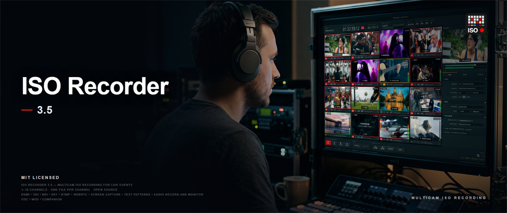

#  ISO Recorder



**ISO Recorder is a multichannel ISO recorder and signal gateway for Windows.** It ingests up to 16 sources — SDI/HDMI,
NDI, SRT, RTSP, WebRTC, cameras and screens — shows them on one multiview, records every source to its own file with
frame-accurate group control, and passes any of them on as NDI or SRT. It is built for multi-camera production, event
and conference capture, contribution-feed logging and any workflow where every source has to be kept in full for
post-production.


[**Download the latest release**](https://github.com/studiokrause/iso-recorder/releases/latest) ·
[Version history](CHANGELOG.md) · [MIT License](LICENSE)

## Why ISO Recorder

- **Many inputs, many outputs.** SRT, RTSP, NDI, WebRTC, DeckLink, UVC and screen capture on the ingest side; MKV,
  MPEG‑TS, MP4 and MOV files in four codecs plus NDI and SRT live outputs on the delivery side — all mixed freely
  between channels.
- **A real scheduler.** Recording windows per channel, pre-rolled so capture starts on the planned second, with a late
  start after a restart and a sleep lock while a job is pending.
- **Scalable.** From one channel on a laptop to 16 channels on a workstation. Every channel is an independent pipeline;
  hardware encoders are detected, verified and shared automatically.
- **Fault-tolerant.** Sources reconnect by themselves, a lost signal does not break the file, a failed channel never
  takes the others down, and an interrupted recording is repaired at the next start.
- **Redundant recording.** Write every channel to two volumes at once, or let a spare volume take over when the main
  one runs low.
- **A familiar interface.** A multiview with tally-style borders, transport buttons, a channel inspector and keyboard
  shortcuts laid out the way vision mixers and recorders have taught operators to expect.
- **Tested on real signals.** Every release is run through an automated suite that records from live SRT, RTSP, NDI,
  NDI|HX and WebRTC senders, cuts their signal mid-recording, kills the program, simulates a full disk and a failed second
  volume — and then verifies the resulting files frame by frame.

## At a glance

| | |
|---|---|
| **Channels** | 1–16, each with its own pipeline |
| **Ingest** | SRT (caller / listener), RTSP, NDI and NDI\|HX, WebRTC (WHEP), Blackmagic DeckLink (SDI / HDMI), UVC cameras and capture cards, screen and window capture, test generator |
| **Recording codecs** | H.264, H.265 (HEVC), AV1, ProRes 422; stream copy (no re-encoding) for SRT and RTSP |
| **Containers** | MKV, MPEG‑TS, MP4, MOV; growing MP4 / MOV (readable while recording) |
| **Encoders** | NVIDIA NVENC, Intel Quick Sync, AMD AMF, Media Foundation; software fallback |
| **Audio** | embedded audio of the source, WASAPI inputs and loopback; AAC; peak meters; monitoring on a chosen sound card |
| **Live output** | NDI or SRT per channel, in parallel with recording |
| **Control** | group REC / PAUSE / STOP / SPLIT on a common clock, scheduler, keyboard shortcuts |
| **Resilience** | automatic reconnection, signal-loss policies, redundant recording, spare volume, crash recovery |
| **Interface** | multiview 2×2 / 3×3 / 4×4, list view, full-size preview; English, Polish, German, Spanish, Italian, French |

## Coming from SRT MiniServer?

ISO Recorder covers the same core gateway workflow: up to 16 SRT inputs in caller or listener mode, decoded, monitored
on a multiview and handed on to NDI — so remote contribution feeds become NDI sources for vMix, OBS, TriCaster or any
other NDI-aware switcher.

On top of that it is a recorder and works with far more than SRT:

- **ISO recording** of every channel, with pause / resume, manual and automatic file splitting and a sidecar file for
  conforming in the edit,
- **more ingest formats**: RTSP, NDI, WebRTC (WHEP), DeckLink, cameras, screen and window capture,
- **stream copy**: an SRT or RTSP stream written to disk as received, without a generation loss,
- **scheduler** with starts on the planned second,
- **redundant recording** to two volumes and automatic switch-over to a spare volume,
- **SRT output** next to NDI.

What it does not do: SDI output, RTMP / HLS / UDP multicast outputs and audio channel routing. If you need those, keep
using a dedicated gateway.

*ISO Recorder is an independent open-source project and is not affiliated with the makers of SRT MiniServer.*

## Features

### Ingest

- **SRT** in caller or listener mode, **RTSP** (UDP or TCP interleaved), **NDI** with automatic source discovery
  (full NDI and NDI|HX), **WebRTC** from a WHEP endpoint.
- **Blackmagic DeckLink** SDI / HDMI with automatic video-mode detection and deinterlacing
  *(implemented, not yet verified on hardware)*.
- **UVC cameras and capture cards** with selectable resolution and frame rate; **screen** and single-**window** capture.
- Per-channel raster (720p to 1080p and other aspect ratios with letterboxing) and frame rate: 24 / 25 / 30 / 50 / 60 fps.
- Input gain, audio from the source or from any WASAPI device, system-sound loopback.
- Test generator with bars, patterns, a digital and an analog clock, tone and ticks — for line-up and latency checks.
- A channel can be switched off without removing it from the list.

### Recording

- **Codecs**: H.264, H.265 (HEVC), AV1 and ProRes 422, with AAC audio. The hardware encoder is selected automatically
  and verified with a real test encode; the choice can be forced per channel.
- **Stream copy** for SRT and RTSP: the elementary streams are remuxed as received — the sender's codec, bitrate and
  time stamps, no encoder load.
- **Containers**: MKV and MPEG‑TS (both stay readable after a crash), MP4 and MOV.
- **Growing files**: MP4 / MOV can be written in 1-second fragments with the index first, so the file opens in the editing
  program while it is still being recorded (after a crash such a file is often, but not always, still readable —
  use MKV or MPEG‑TS when crash safety matters).
- **Pause and resume inside one file** with a continuous timeline.
- **Splitting** on a key frame: by hand, every N minutes, every N GB, or into a new folder.
- **Group transport**: REC, PAUSE, STOP and SPLIT for any selection of channels at the same instant; all channels run
  on one clock, so the files share a common zero point.
- **Sidecar `.json`** next to every recording: clock time of the first and last frame, parts, pauses and signal losses.
- File-name templates with session, channel, index, source, date, time and part number.

### Scheduler

- Recording rules per channel: weekly on chosen days or once on a chosen date, optionally with a new file part every
  N minutes.
- The recording branch is pre-rolled, so capture starts on the planned second and channels with the same start time
  start together.
- Late start when the program was not running at the start time; the system is kept awake while a recording is running
  or pending.
- The schedule follows the wall clock, so sleep, clock changes and daylight-saving transitions neither lose nor repeat
  a recording.
- Live output can follow the recording schedule.

### Live output

- Any channel can be sent out as **NDI** or **SRT** (MPEG‑TS, H.264 + AAC, caller or listener) while it is recorded —
  or without recording at all. The output can be switched on and off during a recording.

### Fault tolerance and redundancy

- **Signal loss** on a network source: keep recording with a slate (last frame, then black), pause, or start a new
  file part — selectable per channel. The source reconnects by itself.
- A failed local source is restarted automatically and an interrupted recording resumes in a new file; a
  "Reconnect source" button handles devices that hang.
- **Redundant recording**: the same recording written to two folders at once. A failure of the second volume does not
  stop the recording on the main one.
- **Spare volume**: when free space on the main volume drops below a set limit, the recording continues in a second
  folder as a new file part, without losing a frame.
- **Crash recovery**: recordings interrupted by a program or power failure are detected at the next start and the
  interrupted MKV part is rewritten with its duration and index.
- Free-space watch per volume with a time-remaining estimate, a write-speed test, a controlled stop before a volume
  fills up.
- Channel-list autosave, event log on disk.

### Remote control

- **OSC** over UDP (default port 8000): REC / STOP / PAUSE / SPLIT / SELECT of every channel, the same for the selected channels,
  select all / none / invert, and the view (2×2, 3×3, 4×4, list). Status comes back as standard `/isorec/...` paths.
- **MIDI** with **MIDI learn**: a list of all commands in Settings, assign any note or controller to each; button lights are sent back to the controller.
- **Stream Deck** through a **Bitfocus Companion** module (included): actions, feedbacks, variables and ready-made button presets.
- Full reference: [docs/Remote-Control.md](docs/Remote-Control.md).

### Interface

- Multiview with tally-style borders, audio meters, recording time and live-output markers; list view with sortable
  columns; full-size preview of any channel.
- Inspector with Input, Output and Scheduler tabs for the active channel; settings that must not change mid-take are
  locked while recording.
- Channel lists saved to and loaded from files; default container, codec, encoder, resolution and frame rate for new channels.
- **Editable keyboard shortcuts** (Settings → Keyboard shortcuts). Defaults: `R` record, `P` pause, `S` stop, `X`
  split, `Ctrl+A` select all, `Ctrl+S` save the list, arrow keys change the active channel. Actions on the selected
  channels, views, listening and the windows can get keys of their own. Double-click a picture for the full-size preview.

## Testing

The repository contains the test suite that every release has to pass (`tests\`, PowerShell + `ffprobe`). It drives the
real program against real senders rather than mocks:

| Area | What is exercised |
|---|---|
| Recording | 1–16 channels, pause, split, split to folder, auto-split; frame counts and A/V alignment checked in the files |
| Group sync | common start, pause and stop for 16 channels, compared on the shared clock |
| Network ingest | SRT, RTSP, NDI and WebRTC senders stopped and restarted mid-recording; all three signal-loss policies |
| Stream copy | file compared with the incoming stream: codec, bitrate, key-frame starts, continuous time stamps |
| Codecs and containers | every allowed codec × container pair, plus ProRes 1080p in real time |
| Scheduler | start on the planned second, split, late start, live output inside the window; daylight-saving maths |
| Redundancy | two-folder recording, failure of the second folder, switch to the spare volume |
| Crash recovery | the program is killed mid-recording, then the files are repaired and verified |
| Live output | SRT and NDI outputs received and checked while recording |

NDI ingest was additionally verified with live NDI and NDI|HX sources on a local network, and SRT ingest with an
external SRT sender. DeckLink input and
the NVENC / AMF encoders for H.265 and AV1 have not been run on hardware yet.

## Requirements

- Windows 10 (version 1903 or later) or Windows 11, 64-bit.
- A GPU with a hardware H.264 encoder is recommended; without one a software encoder is used.
- NDI input and output need [NDI Tools](https://ndi.video/tools/) or the NDI Runtime.
- DeckLink input needs Blackmagic Desktop Video.

Capacity depends on the encoder. On the test machine (6 threads, Intel Quick Sync) 8 channels of 720p25 H.264 take about
2.3 CPU cores and 16 channels are the limit. ProRes and software AV1 are encoded on the CPU.

## Installation

From [Releases](https://github.com/studiokrause/iso-recorder/releases) take one of:

- **Installer** — `IsoRecorder-<version>-setup.exe`. No administrator rights needed; it adds a Start menu shortcut and
  an uninstaller.
- **Portable** — `IsoRecorder-<version>-win64.zip`. Unpack it anywhere and run `IsoRecorder.exe`.

Qt and GStreamer are included; nothing else has to be installed.

If the program will not start with the last used channel list, hold **Shift** while launching it — it opens with an
empty list.

## Quick start

1. **ADD SOURCE** adds a channel. On the **Input** tab choose the input type and the device or address.
2. On the **Output** tab set the recording folder, container, codec and bitrate; **Live output** is there too. The
   **Scheduler** tab holds the recording rules of the channel.
3. **REC** on a tile records one channel; select several channels and use the **Selected channels** panel to roll
   them together.
4. **SAVE** stores the channel list in a file — the program reopens it at the next start.

## Building from source

You need Visual Studio Build Tools (C++ and CMake), Qt 6 in `C:\Qt\<version>\msvc*_64` and GStreamer 1.28 MSVC x64
(runtime and development packages).

```powershell
scripts\build.ps1      # builds into build\
scripts\run.ps1        # runs with the right paths
scripts\package.ps1    # assembles a standalone package in dist\IsoRecorder\
scripts\installer.ps1  # builds the installer from that package (needs Inno Setup 6)
```

## Documentation

- [docs/Remote-Control.md](docs/Remote-Control.md) — OSC, MIDI and Stream Deck / Companion reference (English).

The other project documents are written in Polish:

- [CHANGELOG.md](CHANGELOG.md) — version history,
- [instrukcja_koncowa.md](instrukcja_koncowa.md) — specification and how the mechanisms work,
- [AGENTS.md](AGENTS.md) — project state, working rules and known limits.

## License

ISO Recorder is released under the [MIT License](LICENSE).

The binary packages include [Qt](https://www.qt.io/) and [GStreamer](https://gstreamer.freedesktop.org/) with its
plugins, which are distributed under the LGPL; only LGPL-, BSD- and MIT-licensed components are shipped. NDI is a
registered trademark of Vizrt NDI AB. SRT MiniServer is a product of its respective owner.

## Authors

Studio Krause + Claude Fable 5.2
